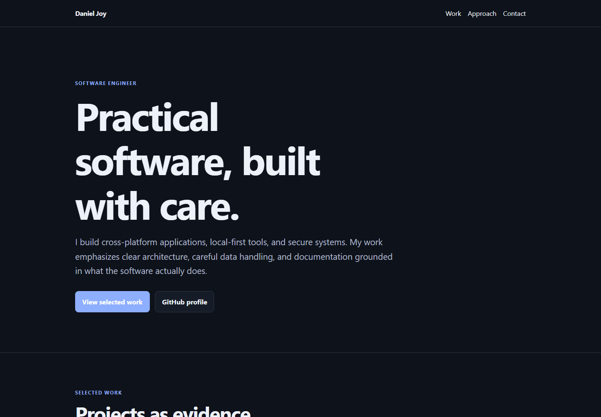
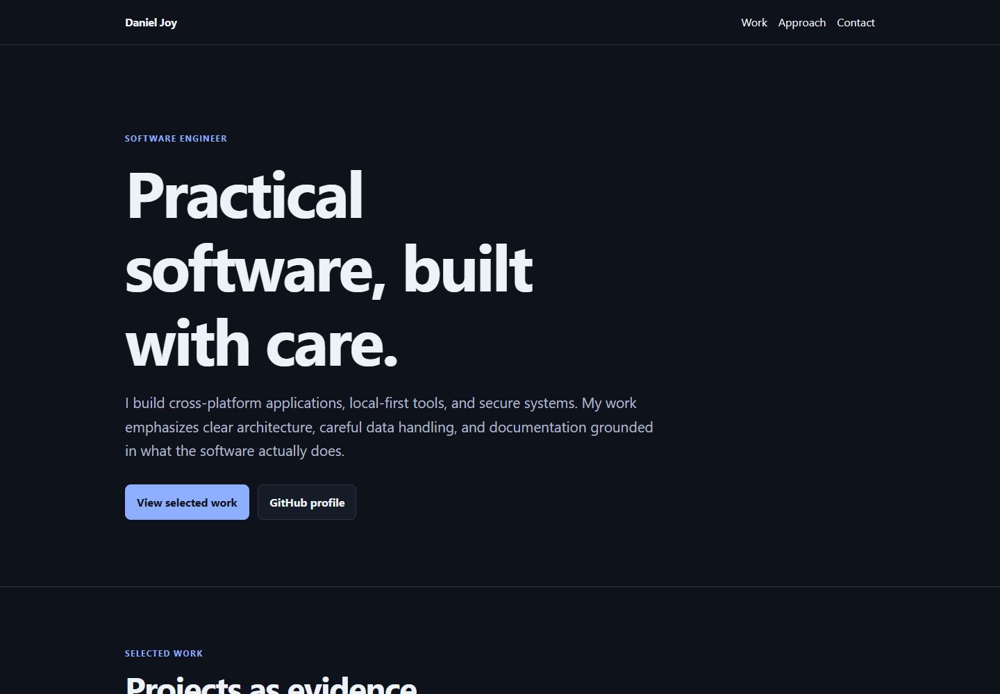
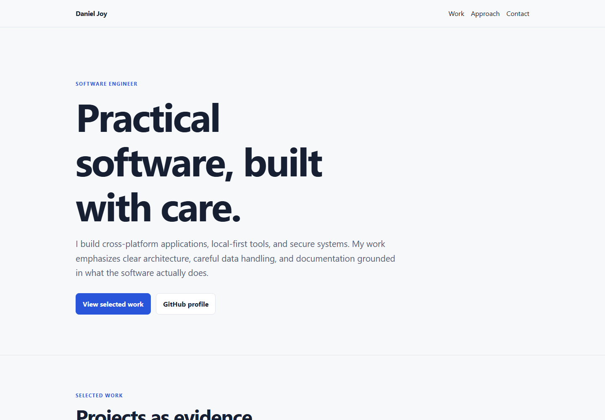

# Portfolio contrast validation

These local Chromium captures document the primary-button contrast correction
included in this pull request. They are review evidence only and are not loaded
by the portfolio page.

## Before

White text on the dark-mode accent background measured **2.18:1**, below the
WCAG AA requirement for normal text.

## After

The corrected dark-mode combination, `#0e121a` on `#8eaeff`, measures
**8.61:1**.

The light-mode combination remains white on `#2855d9` and measures **6.19:1**.

## Additional checks

- Responsive rendering checked at 360, 390, 768, and 1440 CSS pixels.
- No horizontal overflow was detected in the exact-viewport validation run.
- All internal fragment links resolve.
- Keyboard focus reaches the primary navigation and uses a visible 3 px outline.
- Reduced-motion mode changes smooth scrolling to `auto`.
- Light and dark color schemes render with the intended variables.

The screenshots were produced from local files rather than a deployed Pages
preview. Device verification remains recommended before merge.
